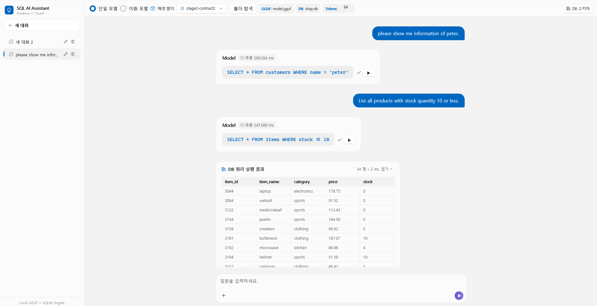
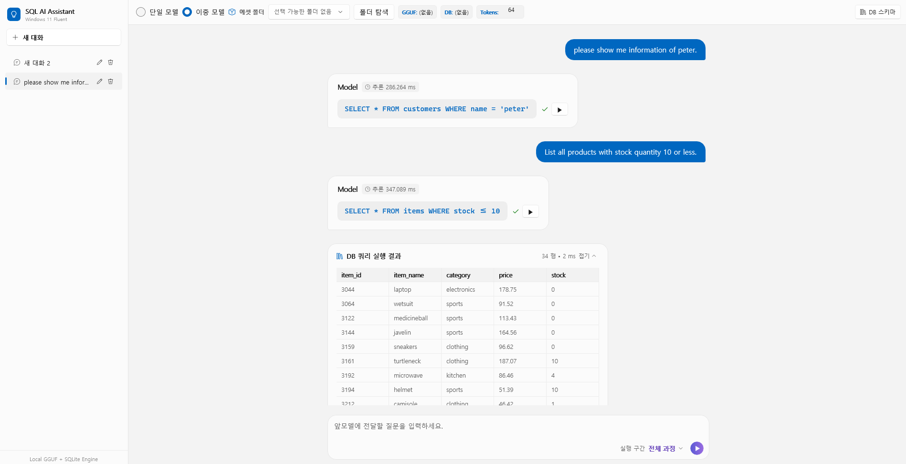

# Capstone SQL GUI

영어 질문을 로컬 GGUF 모델로 SQL로 변환하고 SQLite DB에서 조회하는 데스크톱 앱입니다. **단일 모델**은 질문에서 SQL을 바로 생성합니다. **이중 모델**은 앞모델부터 원하는 단계까지 실행하거나, 일반화 질문을 입력해 뒷모델만 실행할 수 있습니다. 두 모드 모두 **에셋 폴더**에서 파일을 폴더 단위로 선택합니다. 질문과 태그는 모델이 학습한 대소문자로 입력하세요.

## 실행 화면 예시

**단일 모델**



**이중 모델**



## 🛠️ 기술 스택 및 실행 환경

| 구분 | Windows x64 | macOS |
| --- | --- | --- |
| GUI | Windows 11 · WinUI 3 | Uno Platform · Skia Desktop |
| GUI 빌드 | .NET 10 SDK, Windows SDK 10.0.26100 | Mac CPU에 맞는 .NET 10 SDK |
| C 추론기 빌드 | Visual Studio의 **C++를 사용한 데스크톱 개발** 워크로드 및 CMake 도구 | Xcode Command Line Tools의 Apple Clang, CMake 3.16 이상 |
| 실행 시 사용하는 추론 라이브러리 | `sql_engine.dll` | `libsql_engine.dylib` |

아래 명령은 모두 `SqlApp.sln`이 있는 **저장소 루트**에서 실행합니다. [Windows 빌드, 실행 및 배포](#3-windows-빌드-실행-및-배포) · [macOS 빌드 및 실행](#4-macos-빌드-및-실행)

## 1. 프로젝트 구조

`app/`에는 C# 데스크톱 앱과 토크나이저·매퍼·후처리기가 있습니다. `native/`에는 단일 모델과 이중 모델의 앞·뒷모델이 공통으로 사용하는 C11 추론 라이브러리가 있습니다. 두 프로젝트를 연결하는 C# 바인딩은 `app/Interop/SqlEngine/`에 있습니다.

```text
capstone-sql-cli/
├── SqlApp.sln                    # app/SqlApp.csproj를 포함하는 솔루션
├── global.json                   # Uno SDK 버전 설정
├── app/
│   ├── SqlApp.csproj             # Windows·macOS용 .NET 앱 프로젝트
│   ├── MainPage.xaml             # 메인 페이지
│   ├── Controls/                 # 독립 XAML 컨트롤
│   ├── Models/                   # 대화, 매핑 후보, 실행 결과 자료형
│   ├── ViewModels/               # 화면 상태, 명령, 서비스 연결
│   ├── Services/                 # 에셋 탐색, 추론 호출, SQLite, 대화 저장
│   │   └── Pipeline/             # 단계 실행, 매퍼, 후처리기
│   ├── Interop/SqlEngine/        # GGUF 메타데이터, 토크나이저, C API 바인딩
│   └── runtimes/<RID>/native/    # 플랫폼별 네이티브 라이브러리 복사 위치
├── native/
│   ├── CMakeLists.txt            # C 라이브러리와 CTest 빌드 설정
│   └── sql_engine/
│       ├── sql_engine.c          # GGUF 추론기 구현
│       ├── sql_engine.h          # 공개 C API
│       └── tests/                # C 추론기 단위·회귀 테스트
├── Makefile                      # 네이티브 빌드·테스트용 CMake 래퍼
├── assets/                       # 로컬 실행용 모델과 DB를 묶음별로 보관
├── scripts/fetch-asset           # 단일 모델과 DB 다운로드
├── fixtures/
│   ├── v2/                       # GGUF 계약 검증용 소형 모델과 기준 출력
│   └── dual/                     # 이중 모델 파이프라인의 입력·기대 결과 JSON
├── tests/SqlApp.Tests/           # 독립 실행형 .NET 회귀·통합 테스트 프로젝트
├── .github/workflows/test.yml    # Linux에서 C 추론기 빌드·테스트·서식 검사
└── CONTRACT.md                   # GGUF 형식과 C API 계약
```

CMake는 추론 라이브러리를 빌드해 `app/runtimes/<RID>/native/`에 복사합니다. 앱 프로젝트는 대상 플랫폼에 맞는 라이브러리를 빌드·배포 출력에 포함합니다. [네이티브 빌드 설정](native/CMakeLists.txt) · [앱 프로젝트 설정](app/SqlApp.csproj)

`assets/`의 모델·DB는 Git에서 제외합니다. `fixtures/`의 소형 모델과 JSON은 테스트 입력으로 저장소에 포함합니다. C# 테스트 프로젝트는 솔루션과 별도로 앱의 모델·서비스·네이티브 연동 소스를 직접 컴파일합니다. [테스트 프로젝트 설정](tests/SqlApp.Tests/SqlApp.Tests.csproj)

[앱 소스 구조](app/ReadMe.md#앱-소스-구조) · [GGUF 계약과 C API](CONTRACT.md)

## 2. 모델과 DB 받기

다운로드 스크립트는 같은 릴리스의 `model.gguf`와 `shop.db`를 `assets/<태그>/`에 함께 저장합니다. 태그를 생략하면 공개된 `stage<N>-contract2` 계열에서 가장 높은 단계를 고릅니다. 같은 단계에서는 정식 태그, 그다음은 번호가 큰 RC를 우선합니다. 두 파일의 SHA-256을 모두 확인한 뒤 설치합니다. [학습 저장소 릴리스](https://github.com/polring/capstone-design-1/releases)

앱은 작업 폴더와 앱 실행 폴더의 상위 경로에서 `assets/`를 찾습니다. **단일 모델**에서는 모델과 DB가 함께 들어 있는 폴더를 표시합니다. 새 대화는 stage와 contract 번호가 높은 폴더를 우선하며, 두 번호가 같으면 정식 태그를 우선합니다.

다른 경로에 두 파일이 있다면 **폴더 탐색**으로 해당 폴더를 선택하세요. 그 폴더가 목록에 추가되고 모델과 DB가 현재 대화에 함께 적용됩니다. 앱을 다시 열면 저장된 대화의 폴더 경로를 확인해 복원합니다.

**Windows · Developer Command Prompt for Visual Studio**

```
bash scripts/fetch-asset
```

**macOS · 터미널**

```
bash scripts/fetch-asset
```

**특정 릴리스 받기 · Windows와 macOS 공통**

```
bash scripts/fetch-asset stage2-contract2
```

### SQL 실행과 대화 기록

단일 모델의 SQL과 이중 모델의 최종 SQL은 후보가 하나일 때도 같은 검사를 거칩니다. 앱은 해당 응답의 DB에서 읽기 전용 조회문 한 개를 준비해 문법과 테이블·컬럼을 확인합니다. **✓**는 실행 가능, **✕**는 실행 불가이며 실패 사유를 함께 표시합니다. **실행**을 누르면 선택한 SQL을 다시 검사한 뒤 최대 100행을 보여 줍니다. 다른 후보의 복원이 실패해도 성공한 후보는 개별 실행할 수 있습니다.

단일·이중 모델 모두 화면 상단의 **선택된 DB 바로 오른쪽**에서 **Max Tokens**를 조절합니다. 모델 한 단계가 생성할 수 있는 토큰 수이며, 새 대화의 기본값은 64입니다. 단일 모델은 토큰 한도나 문맥 길이에 도달하면 생성된 부분까지 표시하고 유효한 SQL은 실행할 수 있습니다. 이중 모델은 해당 모델 단계의 부분 출력과 종료 사유를 남기고 구간 실행을 중단합니다.

대화, 폴더, 실행 구간, 후보와 조회 결과는 로컬에 저장합니다. 앱을 다시 열면 각 응답에 기록된 DB에서 SQL을 다시 검사합니다. **추론** 시간은 C에서 측정한 모델 계산 시간이며, 이중 모델에서는 실행한 모델 단계의 합계와 각 단계의 시간을 확인할 수 있습니다. 예전 대화에 저장된 전체 소요 시간은 **응답**으로 표시합니다.

---

## 3. Windows 빌드, 실행 및 배포

### 1) 빌드 — Developer Command Prompt for Visual Studio

중단점에서 멈춰 변수 값을 확인하려면 Debug를, 배포용으로 최적화하려면 Release를 선택하세요. Developer Command Prompt에서는 원하는 구성의 `#` 설명 줄 아래에 있는 명령 세 줄만 복사해 저장소 루트에서 실행하세요.

```
# 디버그 빌드
cmake -S native -B build -A x64
cmake --build build --config Debug --clean-first
dotnet build app/SqlApp.csproj -f net10.0-windows10.0.26100 -c Debug

# 또는 릴리즈 빌드
cmake -S native -B build -A x64
cmake --build build --config Release --clean-first
dotnet build app/SqlApp.csproj -f net10.0-windows10.0.26100 -c Release
```

두 구성 모두 추론기 DLL을 `app/runtimes/win-x64/native/sql_engine.dll`에 복사합니다. `--clean-first`로 다시 빌드하면 구성을 바꿔도 앱에 해당 구성의 DLL이 포함됩니다.

### 2) 실행 — 빌드한 GUI 열기

저장소 루트에서 빌드한 구성에 맞는 명령 하나를 실행하세요.

```
# 디버그 빌드 실행
.\app\bin\Debug\net10.0-windows10.0.26100\SqlApp.exe

# 또는 릴리즈 빌드 실행
.\app\bin\Release\net10.0-windows10.0.26100\SqlApp.exe
```

새 대화에서 영어 질문을 입력하고, 생성된 SQL 옆의 **실행**을 눌러 DB를 조회합니다. 다른 모델과 DB를 사용하려면 상단의 **에셋 폴더** 목록에서 바꾸거나 **폴더 탐색**에서 사용할 폴더를 여세요.

### 3) 배포 — Windows x64 ZIP 만들기

위의 릴리즈 빌드를 마친 뒤 .NET 런타임을 포함한 게시 폴더를 만듭니다.

```
dotnet publish app/SqlApp.csproj -f net10.0-windows10.0.26100 -c Release -r win-x64 --self-contained -o build/publish/win-x64
```

실행 파일과 DLL이 함께 배포되도록 게시 폴더 전체를 압축합니다.

```
tar.exe -a -cf build\SqlApp-win-x64.zip -C build\publish\win-x64 .
```

**배포 파일**은 `build/SqlApp-win-x64.zip`입니다. 받는 사람은 ZIP 전체를 한 폴더에 풀고, `SqlApp.exe` 옆의 `assets/<버전>/`에 사용할 모드의 모델과 DB를 넣습니다. 이미 에셋 폴더가 있다면 앱에서 **폴더 탐색**으로 열어도 됩니다. C 추론기에는 Visual C++ 런타임이 필요합니다. 대상 PC에 `VCRUNTIME140.dll`이 없다면 x64 재배포 패키지를 설치하세요. [Microsoft Visual C++ 재배포 패키지](https://learn.microsoft.com/ko-kr/cpp/windows/latest-supported-vc-redist)

---

## 4. macOS 빌드 및 실행

### 1) 빌드 — macOS 터미널

터미널에서 사용하는 아키텍처를 확인합니다. 출력이 `arm64`이면 ARM64용 .NET SDK를, `x86_64`이면 x64용 SDK를 사용하세요.

```
uname -m
```

같은 구성으로 Apple Clang 추론 라이브러리와 Uno Skia 앱을 차례로 빌드합니다.

```
# 디버그 빌드
cmake -S native -B build -DCMAKE_BUILD_TYPE=Debug -DCMAKE_OSX_ARCHITECTURES="$(uname -m)"
cmake --build build --config Debug --clean-first
dotnet build app/SqlApp.csproj -f net10.0-desktop -c Debug

# 또는 릴리즈 빌드
cmake -S native -B build -DCMAKE_BUILD_TYPE=Release -DCMAKE_OSX_ARCHITECTURES="$(uname -m)"
cmake --build build --config Release --clean-first
dotnet build app/SqlApp.csproj -f net10.0-desktop -c Release
```

| Mac CPU | .NET 런타임 식별자(RID) | CMake 빌드 결과 |
| --- | --- | --- |
| Apple Silicon | `osx-arm64` | `app/runtimes/osx-arm64/native/libsql_engine.dylib` |
| Intel | `osx-x64` | `app/runtimes/osx-x64/native/libsql_engine.dylib` |

### 2) 실행 — 빌드한 GUI 열기

앞에서 빌드한 구성에 맞는 명령 하나를 실행합니다.

```
# 디버그 빌드 실행
dotnet run --project app/SqlApp.csproj -f net10.0-desktop -c Debug --no-build --no-launch-profile

# 또는 릴리즈 빌드 실행
dotnet run --project app/SqlApp.csproj -f net10.0-desktop -c Release --no-build --no-launch-profile
```

새 대화에서 영어 질문을 보내면 자동 선택된 모델이 생성한 SQL이 표시됩니다. **에셋 폴더** 목록이나 **폴더 탐색**에서 폴더를 바꾸면 모델과 DB가 함께 전환됩니다.

## 5. 테스트 실행

네이티브 빌드 후 CTest로 9개 테스트를 실행합니다. 네 가지 GGUF fixture에서 다음 토큰의 점수(logits)를 기준값과 대조합니다. 각 위치에서 KV 캐시를 사용한 점수가 전체 입력을 다시 계산한 점수와 일치하는지, 잘못된 입력을 거부한 뒤 핸들을 재사용할 수 있는지도 검사합니다.

**Windows · Developer Command Prompt for Visual Studio**

Debug로 빌드했다면 아래 명령에서 `-C Release`를 `-C Debug`로 바꾸세요.

```
cmake -E chdir build ctest -C Release --output-on-failure
```

**macOS · 터미널**

```
cmake -E chdir build ctest -C Release --output-on-failure
```

**GNU Make를 사용하는 경우**

추론 라이브러리를 빌드한 뒤 C 테스트를 실행합니다.

```
make engine
make test
```

C 코드 서식은 [clang-format 설정](.clang-format)을 따릅니다.

아래 명령은 C# 토큰화·생성, GUI의 다섯 실행 구간, 후보별 SQL 검사·실행과 대화 기록 복원을 검증합니다. 합성 앞·뒤 GGUF를 사용하는 통합 테스트는 값의 경계가 둘일 때도 뒷모델 호출 한 번으로 두 SQL을 복원하는지 확인합니다. 학습된 이중 모델의 예측 정확도는 이 테스트의 측정 대상에 포함되지 않습니다.

```
dotnet run --project tests/SqlApp.Tests -c Release
```
